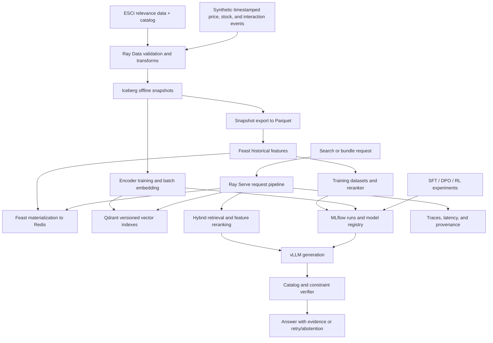

# Cartograph: project design

## Why this project

Build a product search and grounded shopping assistant with a reproducible ML platform behind it. Product search has query/product relevance judgments; recommendations require timely inventory and price features; constrained bundle selection has mechanically checkable outcomes. Together these provide useful reasons to train encoders, align a language model, operate feature stores, and optimize serving.

The finished demo has three views: search and recommendations with evidence; an experiment comparison showing quality versus latency and memory; and a lineage view tracing one answer back to model, data, index, and feature versions. The portfolio centerpiece is the experiment report and reproducible code.

Primary user tasks:

1. Semantic search: “quiet keyboard for a shared office.”
2. Product comparison: compare supported catalog attributes, acknowledge missing facts.
3. Constrained bundles: select distinct, in-stock items satisfying category and budget constraints.
4. Grounded refusal: explain when the catalog cannot satisfy a request.

No real purchases, real user profiles, or scraped customer data are needed.

## Architecture

The diagram is the target architecture. The CPU fixture is a small executable foundation, not an implementation of these services.

Online path: validate request → retrieve candidates → batch-fetch product features → rerank → send a bounded evidence set to the model → verify its structured selection → render the answer. Inventory and price must be fetched from current features, rather than memorized in the encoder or language model. Carry a snapshot/as-of timestamp through the answer and revalidate if a retry uses newer features.

Train and serve at different times on the 3090. Put the initial encoder, reranker, and databases on CPU while the language model occupies the GPU. Do not assume fractional Ray GPU assignments impose VRAM isolation.

## Coverage and evidence

| Requested capability | Concrete use | Evidence needed before claiming completion |
|---|---|---|
| Batching | vLLM continuous batching; dynamic embedding batches in Ray Serve | Throughput/latency curves across load and batch limits |
| Quantization | Compare BF16/FP16 with a supported 4-bit weight format on the same model | Memory, output quality, and speed measured together |
| KV caching | Paged KV management and shared-prefix caching | Cold/warm prefill measurements, cache hits, KV capacity under concurrency |
| Tensor parallelism | Separate two-GPU vLLM experiment | TP=1 vs TP=2 on the same multi-GPU host, topology and communication evidence |
| Model serving | Ray Serve handles pipeline orchestration; vLLM handles generation scheduling | Load test, bounded queues, timeouts, health checks, recovery trace |
| Encoder fine-tuning | Contrastive training, graded pairwise ranking, hard-negative mining | Held-out NDCG and recall, ablation against untouched encoder |
| Pooling | Mean vs CLS pooling under controlled training | Quality and latency comparison with equal training budgets |
| Dimensionality | Full vectors vs PCA vs Matryoshka-trained prefixes | Quality/storage/search-latency frontier |
| Vector databases | Qdrant dense retrieval plus lexical retrieval and fusion | Exact-search vs ANN recall and HNSW tuning report |
| SFT and LoRA | Learn grounded response format and catalog tool behavior | Adapter artifacts, held-out task success, training logs |
| DPO | Prefer factual, useful answers over unsupported recommendations | Blind held-out preference evaluation and failure slices |
| Reward modeling | Train a small scalar scorer on labeled answer pairs | Held-out pairwise accuracy and bias analysis |
| RLHF | Optimize a small policy against the learned human-preference reward | Genuine human labels, online rollout logs, KL and reward curves |
| RLVR and GRPO | Optimize bundle constraint satisfaction using a deterministic verifier | Held-out verifier success and reward-hacking tests |
| Feature engineering/serving | Feast + Redis: stock, price, smoothed popularity, feature age | Historical correctness, online/offline parity, stale-feature behavior |
| Distributed processing | Ray Data ingest, transforms, embedding jobs, retries | Multi-worker execution and controlled worker-failure recovery |
| Offline storage | Iceberg tables with explicit snapshot exports | Snapshot reproducibility, late-event handling, schema evolution |
| Kubernetes/cloud | KubeRay locally on Linux; one AWS deployment milestone | Reproducible deployment, GPU scheduling, restart/rollback evidence |
| Governance/lineage | MLflow registry + dataset/index manifests + release gates | Trace an answer to its inputs; reject a bad model and roll back |

TensorRT-LLM is an optional serving comparison after the core report. Spark/Flink, Tecton/Hopsworks, Delta/Lance, and Cassandra/DynamoDB are alternative technologies in the original categories. Adding all of them provides little evidence beyond installation; write an architecture decision record explaining the chosen representatives. If exact named-tool experience later becomes necessary, add one bounded comparison at a time.

## Data design

Use the US English subset of Amazon's ESCI shopping queries for retrieval relevance. It provides Exact/Substitute/Complement/Irrelevant judgments and product information. Start with 5,000 training queries, then scale after pipeline validation. These are query-product relevance labels, not answer preference or shopping interaction data. [Dataset source](https://github.com/amazon-science/esci-data).

Keep three distinct sources:

- **Relevance data:** real ESCI judgments and source product fields.
- **Operational simulation:** generated stock, prices, timestamps, and interaction events; tagged `synthetic=true`, fixed seeds, documented simulator.
- **Alignment data:** authored or generated instruction/answer examples and separately collected human preferences; preserve provenance per row.

Do not invent prices, clicks, sales, or preference annotations and attribute them to ESCI. Do not report simulator improvements as real revenue or conversion gains.

Retain the official held-out split. Split development data by normalized query groups; report and resolve overlaps before training. Keep a separate cold-product test slice. Fit PCA, mine negatives, construct demonstrations, and select hyperparameters using training/development data only. Catalog text for held-out retrieval candidates is accessible at indexing time; held-out relevance judgments are not training signals.

Proposed schemas:

| Artifact | Required fields |
|---|---|
| Product | `(product_id, locale)`, title, source text, source/version/license |
| Relevance | query_id, normalized_query_group, product_id, locale, ESCI label, split |
| Operational event | event_id, product_id, event_time, available_at, event_type, payload, synthetic |
| Feature row | product_id, event_timestamp, available_at, feature_version, price_cents, in_stock, popularity_7d, feature_age |
| Alignment example | example_id, prompt, evidence IDs/version, target or chosen/rejected, label_source, split |
| Request trace | request_id, model/adapter revision, index version, feature as-of, evidence IDs, verifier result, timings |

Feast's point-in-time joins address historical event time; late-arriving data also requires availability-time filtering in the prepared source. The export stage must ensure both timestamps precede the training cutoff. Export an immutable Iceberg snapshot to Parquet with a manifest, and let Feast use its file offline store initially. This is an explicit adapter boundary, not a claim of native Feast–Iceberg integration. [Feast historical joins](https://docs.feast.dev/getting-started/concepts/point-in-time-joins), [local provider](https://docs.feast.dev/reference/providers/local).

## Model choices and hardware

Start with `Qwen/Qwen2.5-1.5B-Instruct` for generation and alignment because it is small enough to make repeatable experiments a plausible fit for 24 GB. This is a starting candidate, not a promise of task quality or measured memory usage. Its model card lists Apache 2.0. Resolve and save an immutable revision before downloading. [Model card](https://huggingface.co/Qwen/Qwen2.5-1.5B-Instruct).

Use a compact Sentence Transformers encoder as the initial frozen baseline; `sentence-transformers/all-MiniLM-L6-v2` is a candidate to validate at the dependency/model-lock milestone. Start with its native embedding size; build controlled mean/CLS variants from the same backbone. Consider a larger encoder only if the baseline leaves a clear quality gap.

Run SFT/DPO using LoRA, and compare QLoRA when memory makes it useful. Start online RL with a 0.5B–1.5B policy, short contexts, small rollout groups, gradient checkpointing, and microbatch one. Run reward scoring sequentially or on CPU when necessary. A 7B quantized serving or QLoRA experiment is an extension after actual memory profiling. Do not promise 7B online RL on this machine.

One GPU cannot demonstrate useful cross-GPU tensor parallel scaling. TP=1 is the local baseline; TP=2 needs a second physical GPU. Use a short AWS multi-GPU run later if available, comparing both settings on the same host and GPU type. [vLLM parallelism](https://docs.vllm.ai/en/latest/serving/parallelism_scaling/).

## Governance as observable behavior

Each promotion binds data snapshot, feature definitions, encoder, vector index, generator, adapter, verifier, dependency lock, and evaluation report. Save source licenses, dataset cards, model cards, limitations, and human-label provenance. Keep raw prompts out of default telemetry; synthetic user IDs suffice for the demo.

Demonstrate a failed release: a smaller embedding index degrades NDCG beyond its allowed margin, so the promotion gate rejects it. Demonstrate rollback by restoring the previous model/index/feature bundle and replaying a saved request. Exercise deletion of a synthetic product through offline data, Redis, Qdrant, and caches, documenting that backups and trained weights require separate retention/retraining policies. These are governance engineering controls, not a claim of legal compliance certification.
