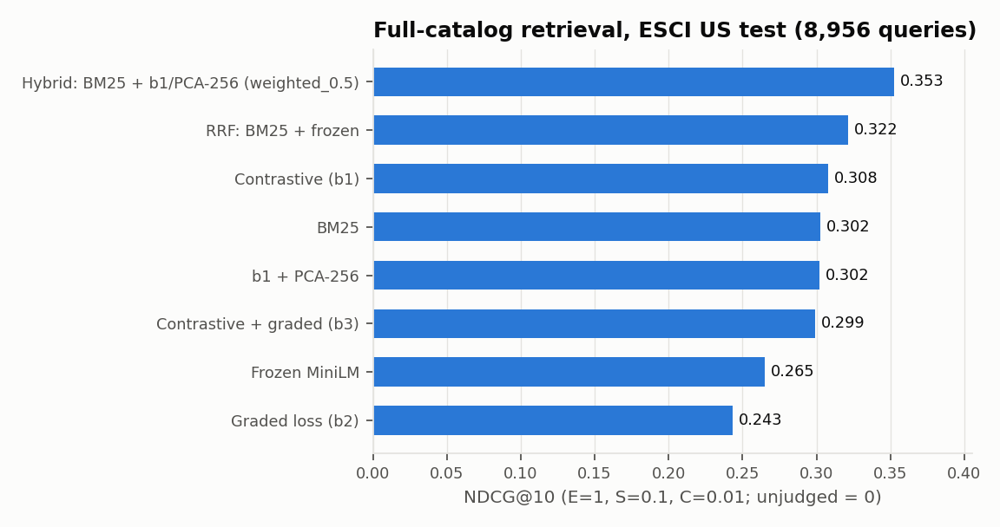
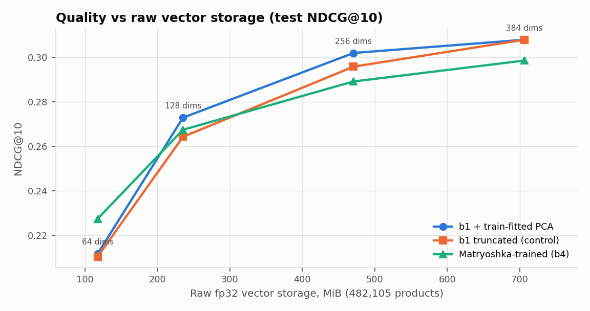
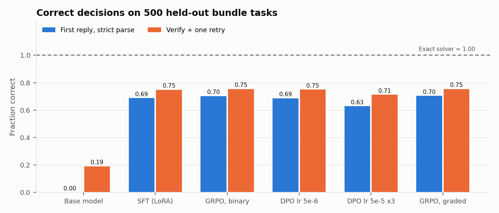
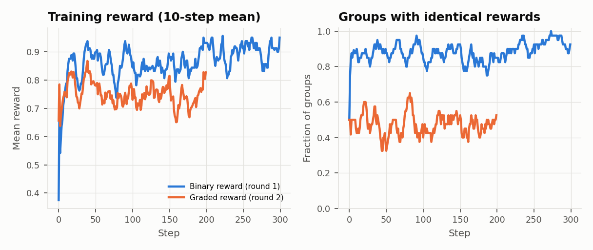
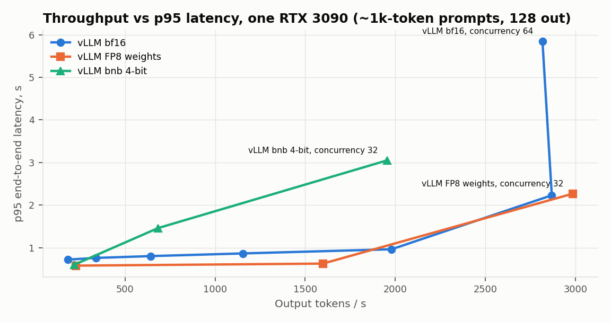

# Cartograph: technical report

A grounded product-discovery assistant that retrieves products, reads current (synthetic) price and stock, selects
bundles under hard constraints, and verifies every answer, plus measured tradeoffs in retrieval quality, answer
correctness, latency, throughput, GPU memory, and reliability.

All numbers below are copied from committed evidence under `experiments/` (each has a config, environment lock,
manifest with code commit and input checksums, metrics, per-example outputs, and raw logs). Figures are regenerated
from that evidence by `python3 -m cartograph.report_figures`. Status labels follow `docs/LEDGER.md`.

**Hardware.** Development on a Mac (M2, 8 GB). Experiments on a shared lab host: Threadripper 3960X, 251 GB RAM,
2× RTX 3090 (24 GB, PCIe, no NVLink), driver 570.207. GPU 0 fell off the PCIe bus twice (NVIDIA Xid 79), both times
while both GPUs were under load, so every GPU result here comes from **GPU 1 alone**, one job at a time. Some early
experiments ran on CPU while the GPUs were unavailable; each is labeled.

## 1. Data

- **Relevance:** Amazon ESCI (commit `7916cdf6`, Apache-2.0), US locale, `small_version = 1`: 482,105 products;
  18,777 train, 2,089 dev (hashed 10% of query groups), and 8,956 official test queries. Query groups are
  token-sorted normalized text; 22 train groups that also occur in test were removed from training. Audit: 0 duplicate
  (query, product) rows; 221 cross-query label conflicts; 74% of test judgments are on products never judged in training.
  `experiments/gate_a/esci_slice/`.
- **Operations (synthetic):** seeded simulator (`ops-sim-v1`, seed 20260901). 30 days of price, stock, and daily
  interaction events for all 482k products (5.05M events), with planted late deliveries, duplicate deliveries, and
  invalid rows. Every row carries `synthetic = true`. None of it is real commerce data.
- **Bundle tasks (synthetic):** 3,000 train and 500 test tasks over disjoint product halves (0 shared products), with
  as-of prices and stock from the feature snapshot. About 80% are feasible; ground truth comes from an exact solver.

## 2. Retrieval (Gates A–B)

Full-catalog NDCG@10 (gains E=1, S=0.1, C=0.01, I=0; unjudged results count as 0) on the 8,956 test queries:

| System | NDCG@10 | Recall@50 (E/S) | Evidence |
|---|---|---|---|
| BM25 | 0.302 | 0.387 | `gate_a/baselines_test_cpu` |
| all-MiniLM-L6-v2, frozen | 0.265 | 0.373 | same |
| RRF(BM25, frozen) | 0.322 | 0.432 | same |
| Contrastive fine-tune with query-aware negatives (b1) | 0.308 | 0.415 | `gate_b/eval_b1_*` |
| b1 + train-fitted PCA-256 | 0.302 | — | `gate_b/dims_b1_test` |
| **Hybrid: BM25 + b1/PCA-256, weighted α=0.5 (dev-selected)** | **0.353** | **0.454** | `gate_b/fusion_b1_pca256` |

- Ranking only the judged candidates tells a different story: frozen MiniLM 0.712 > BM25 0.699. Full-catalog numbers
  are lower bounds, because only about 30% of top-10 results are judged.
- **Negative results:** the graded pairwise loss (E > S > C > I) lowered full-catalog NDCG (0.244 alone, 0.299 with
  contrastive). Mean pooling beat CLS (0.178 vs 0.144 from the raw backbone at equal budget).
- **Compression** (figure): train-fitted PCA keeps 98.1% of NDCG at 256 dims (selected on dev at 98.0%) with 33% less
  raw storage. Matryoshka training only wins at 64 dims.

- **Qdrant (HNSW):** with the selected setting (m=16, ef_construct=100, ef=32) on PCA-256 vectors, top-10 agrees
  with exact search 95.3% of the time, at 3.7 ms p95 per query via the Python client. NDCG cost vs exact search
  −0.008 [−0.011, −0.006]. Raw vector memory is 471 vs 706 MiB (−33%). Qdrant process RSS sampled after each build
  was not consistent (−40% at m=32, +10% at m=16), so no RSS saving is claimed.

## 3. Feature platform (Gate C)

Ray Data (two raylets on one host) validates and dedupes events, commits them to Iceberg (SQL catalog, local
warehouse), and computes availability-correct feature rows. Tagged snapshots are exported to immutable Parquet for
Feast (file offline store) and materialized to Redis.
`experiments/gate_c/drills_v5`: historical features match an independent as-of reference on **5,001/5,001** samples
(a naive event-time join would leak late data in 53 of them); online/offline parity **0 mismatches** (2,000 × 8);
replay appends nothing; the killed worker is retried and output equals the pandas reference; late batches never
rewrite history (2,981/2,981); with Redis down, requests fail closed. Four failed runs are kept; two exposed real
Feast semantics (entity rows dropped when a view's TTL expires).

## 4. Grounded assistant (Gate D) and alignment (Gate E)

Generator: Qwen2.5-1.5B-Instruct (`989aa798`). 500 held-out tasks; "raw" = first reply parsed strictly; "wrapped" =
lenient JSON extraction plus one retry with the verifier's errors. A correct abstention requires the exact solver to
prove infeasibility.

| Model | Correct raw | Correct wrapped | Optimal among valid | Notes |
|---|---|---|---|---|
| Exact solver | 1.000 | 1.000 | 1.000 | Non-LLM baseline |
| Base instruct | 0.000 | 0.190 | — | Code-fenced JSON; refuses almost everything |
| SFT (LoRA r=16, solver demonstrations) | 0.688 | 0.748 | 0.838 | `gate_d/` |
| GRPO, binary verifier reward | 0.702 (+0.012 [−0.022, +0.044]) | 0.754 | **0.593** | reward hacking |
| DPO, verifier pairs, lr 5e-6 (v2) | 0.686 (−0.004 [−0.014, +0.006]) | 0.750 | 0.838 | barely moves |
| DPO, verifier pairs, lr 5e-5 × 3 epochs (v3) | **0.628 (−0.062 [−0.092, −0.032])** | 0.712 | 0.841 | overfits, hurts |
| GRPO, graded verifier reward | 0.704 (+0.014 [−0.004, +0.030]) | 0.754 | 0.830 | regression fixed |

Deltas are paired bootstrap 95% CIs vs the merged SFT checkpoint (0.690 raw). **No alignment branch significantly
improved held-out correctness.** The binary-reward GRPO learned to trade optimality for validity (reward hacking);
the graded reward removed that. DPO either barely moved the policy or, with a
stronger setting, overfit the synthetic pairs and lost 6 points (the first DPO run also truncated its pairs; kept as compromised). The remaining errors are mostly arithmetic on totals and budgets, which the verifier
catches: no unverified bundle is ever shown.

**Not RLHF.** All preference and reward signals above come from the verifier (synthetic). Human-feedback RL needs
owner-labeled pairs (`cartograph/label.py`, `docs/PREFERENCE_RUBRIC.md`) and is pending.

## 5. Serving (Gate F)

Merged SFT model, the 500 task prompts (~1k tokens), 128 forced output tokens, measured with `vllm bench serve`.
`experiments/gate_f/SUMMARY.md`.

- vLLM vs sequential Transformers: 5.2 vs 17.8 ms per output token at concurrency 1; saturated throughput 2,869 vs
  54 output tokens/s. Saturation at about 22 requests/s (concurrency 32). The provisional SLO (p95 TTFT ≤ 1 s, < 1%
  errors) holds up to concurrency 32 and fails at 64.
- **Prefix caching:** warm cache cuts TTFT 3.6× on repeated task prompts. On shared 1,024-token prefixes under load,
  TTFT drops 3.8× and throughput rises 1.75×.
- **KV capacity:** 544,496 tokens at 0.80 utilization (265 full-length requests).
- **Quantization:** FP8 weight-only uses 42% less weight memory, decodes 23–38% faster, and costs −1.4 points raw
  (n.s.) / −1.8 wrapped. bnb 4-bit costs −10.0 points raw (significant), recovered to −1.6 by verify-and-retry, and is
  slower under batching.
- **Ray Serve vs bare vLLM** (same prompts): same per-token decode at low load; about 11% lower saturated throughput
  (19.8 vs 22.4 requests/s at concurrency 32).
- **Served request path** (Ray Serve, live Redis features, in-process vLLM, verifier): 500/500 requests served, 0.824
  correct against the solver oracle on live evidence, p50 766 ms (LLM 757 ms; retrieval + features + solver < 10 ms).
  Stale features (7.5 h) → explicit `stale_features`; Redis down → HTTP 503. Killing the GPU replica: 0/60 requests
  failed, 22.5 s recovery. The first served run found a request-parser bug (0.630 → 0.824 after the fix).

- **Energy:** GPU board power stays near its 350 W cap even at concurrency 1, so energy per request falls 18× from
  concurrency 1 to 32 (66.9 → 3.7 mWh; 0.029 Wh per 1k output tokens). Cost formula and an explicitly *assumed* electricity rate
  are in `experiments/gate_f/SUMMARY.md`.

## 6. Governance (Gate G)

`experiments/gate_g/governance_drill`: release manifests bind data, Iceberg snapshot IDs, feature-export checksums,
PCA basis, encoder and adapter weights, verifier/solver source hashes, and every environment lock. **3,481/3,481**
adversarial replies were rejected (fabricated IDs, duplicates, false totals, out-of-stock swaps, over-budget bundles,
format-only replies, bundles for impossible tasks, false abstention). A 64-dim index release was **rejected** by the
gate (NDCG −30%). The GRPO release passed the gate, was rolled back (its optimality regression wasn't a gate rule), and
four saved requests replayed with identical trace digests.

## 7. What is not done (and why)

| Requirement | Status | Reason |
|---|---|---|
| TP=1 vs TP=2 on two GPUs | blocked_on_hardware | GPU 0 drops off the bus under dual-GPU load; plan in `docs/CLOUD_PLAN.md` |
| Bounded cloud run | planned | No cloud account or budget yet |
| KubeRay on Kubernetes | implemented_unrun | Manifests and drill (`scripts/kuberay_kind.sh`) are ready; Docker Desktop's VM can't reach registries through the VPN |
| Human-feedback RL (reward model on human labels + online RL) | planned | Needs 300–500 owner-labeled pairs |
| Multi-machine Ray | not claimed | Two raylets on one host only |

## 8. Limitations
Prices, stock, interactions, and bundle tasks are synthetic; no conversion or revenue claims follow from them. The
bundle tasks use about 450 distinct products per split, so they test constraint handling more than catalog breadth.
The deterministic request path ranks candidates by BM25 over titles (it once picked a children's karaoke microphone
for "microphone"), and the "quiet" adjective is never actually verified. LLM explanations aren't checked
claim-by-claim; only the structured selection is verified. Every RTX 3090 number comes from one card on a shared machine.
